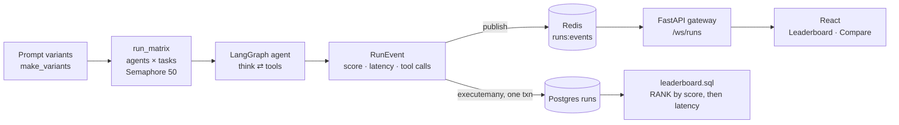

# Agent Benchmarking Platform

**Run many tool-using LLM agents across a task suite in parallel, rank them on a Postgres leaderboard, compare prompt variants head-to-head, and watch results stream into a React dashboard over WebSockets as each run finishes.**

When you're iterating on an agent's prompt or tools, the question is always "is this version actually better, on what, and at what cost?" This platform answers it with a batch runner that fans an agent × task matrix out under a concurrency cap, grades every run, persists it, and publishes it live — so a long evaluation is visible while it's still going.



## Features

- **LangGraph agent loop.** A single `think` node calls the model with tool schemas, executes any requested tools (`calculator`, `lookup`), and loops until the model stops asking for tools.
- **Graded task suite.** Each `Task` carries its own grader; the starter suite mixes arithmetic, knowledge lookup, and a syllogism so a single prompt can't overfit one task type.
- **Bounded parallel evaluation.** `run_matrix` runs every (agent, task) pair through an `asyncio.Semaphore` (default 50) and uses `gather(..., return_exceptions=True)` so one failing run is counted, not fatal.
- **Prompt experiments.** `run_experiment` builds variants from a base prompt plus per-variant instructions, runs the full matrix, persists results, and reports which variant won each task.
- **Leaderboard in SQL.** `db/leaderboard.sql` ranks agents by mean score with mean latency as the tie-breaker, using a `RANK()` window.
- **Live streaming that scales out.** Every finished run is published to Redis; gateway replicas all subscribe and broadcast to connected WebSocket clients, so workers and dashboards scale independently.
- **Prometheus metrics.** Counters and histograms for runs streamed and stream latency.

## Running the parts that work today

```bash
git clone https://github.com/AliAzamat/benchmarking-platform.git
cd benchmarking-platform
pip install langgraph openai "redis>=5" asyncpg prometheus_client fastapi uvicorn

# Leaderboard schema and query (verified on PostgreSQL 16)
createdb eval
psql -d eval -f db/schema.sql
psql -d eval -f db/leaderboard.sql

# Stream gateway (needs Redis on localhost:6379)
uvicorn gateway.server:app --port 8001
```

Running an evaluation needs an `OPENAI_API_KEY` and a small driver script, since there's no CLI yet:

```python
import asyncio
from agent.experiments import run_experiment

wins = asyncio.run(run_experiment(
    "You are a careful assistant. Use tools when helpful.",
    {"terse": "Answer in one word.", "show-work": "Explain briefly, then answer."},
))
print(wins)  # {'terse': <tasks won>, 'show-work': <tasks won>, '_failures': <failed runs>}
```

## Layout

| Path | Purpose |
|---|---|
| `agent/graph.py` | LangGraph state machine: model call → tool execution → loop |
| `agent/tools.py` | Tool schemas and dispatch |
| `agent/tasks.py` | `Task` with prompt and grader; the starter suite |
| `agent/runner.py` | Runs one agent on one task and returns a timed, graded `RunEvent` |
| `agent/parallel.py` | Concurrency-capped agent × task matrix |
| `agent/experiments.py` | Prompt-variant generation and per-task win counts |
| `agent/store.py` | Batched inserts with `asyncpg` |
| `gateway/` | Redis pub/sub bus, WebSocket fan-out server, Prometheus metrics |
| `db/` | `runs` table and leaderboard query |
| `web/` | `Leaderboard` (running averages) and `Compare` (two agents, per task) components |
| [RUNBOOK.md](RUNBOOK.md) | Health checks, common incidents, AWS deployment notes |

## Status and limitations

- **The test file doesn't import:** it expects a `best_variant` helper in `agent/experiments.py` that hasn't been written.
- **No Dockerfiles** for the `gateway` and `agent` build contexts referenced in `docker-compose.yml`, and no dependency file.
- **Connection strings are hard-coded** (`redis://localhost:6379`, `postgresql://localhost/eval`) rather than read from the `REDIS_URL`/`DATABASE_URL` that Compose sets.
- **Gateway sends binary frames** (`send_bytes`), while the React components call `JSON.parse` on `event.data`, which would be a `Blob`; the gateway should send text.
- **The Prometheus metrics aren't exposed or incremented yet** — there's no `/metrics` route on the gateway.
- **The calculator tool uses `eval` with builtins removed.** That's fine for this demo suite, but it isn't a safe sandbox for untrusted expressions.
- The task suite has three tasks; graders are substring checks.
